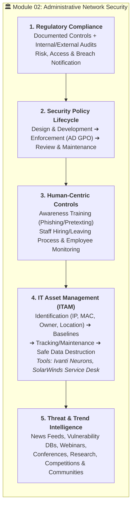

# 📋 Module 02: Administrative Network Security and Governance

**Exam Domain:** Network Defense Management (5 Questions on Exam 312-38)[cite: 12]  
**Core Focus:** Establishing the policies, organizational frameworks, compliance mandates, asset governance, and human-centric operational procedures that govern an enterprise's digital infrastructure[cite: 3, 12].

---

## 🎯 Official Exam Learning Objectives (312-38)
* **LO#01:** Obtain compliance with regulatory frameworks, laws, and acts[cite: 11, 12].
* **LO#02–03:** Design, develop, enforce, and maintain security policies[cite: 4, 12].
* **LO#04:** Conduct security awareness training[cite: 4, 12].
* **LO#05:** Implement other administrative security measures (Managing Staff Hiring/Leaving & Employee Monitoring)[cite: 11, 12].
* **LO#06:** Understand IT Asset Management (ITAM) processes, tools, and best practices[cite: 11, 12].
* **LO#07:** Stay up to date on security trends and threats[cite: 11, 12].

---

## 1. Regulatory Frameworks and Compliance (LO#01)
Technical safeguards are ineffective without administrative governance[cite: 3]. Organizations must comply with strict industry standards, federal laws, and regulatory frameworks[cite: 3, 12]:
* **Documented Controls & Audits:** Compliance requires implementing documented security controls and undergoing regular internal and external audits[cite: 3].
* **Core Regulatory Drivers:** Standard cybersecurity frameworks define baseline requirements for **risk management**, **access management**, and **breach notification**[cite: 3].

---

## 2. Security Policy Engineering Lifecycle (LO#02–03)
A **Security Policy** is a formal, high-level document defining an organization's security goals, acceptable behaviors, and baseline protection requirements[cite: 4]. Engineering a policy follows a structured three-stage lifecycle[cite: 4]:

| Lifecycle Phase | Key Responsibilities & Actions |
| :--- | :--- |
| **1. Design & Development** | Define mandatory rules for acceptable use, password complexity, remote work access, data classification, and incident management[cite: 4, 12]. |
| **2. Enforcement & Oversight** | Implement technical controls that enforce policy rules automatically (e.g., Active Directory Group Policies)[cite: 4]. |
| **3. Review & Maintenance** | Periodically update policy guidelines to account for emerging technological shifts and newly discovered threats[cite: 4]. |

---

## 3. Security Awareness & Administrative HR Measures (LO#04–05)
Because human error remains a frequent vulnerability, administrative security must govern personnel throughout their employment lifecycle[cite: 4, 11]:

* **Continuous Security Awareness Training:** Builds a security-focused culture to defend against social engineering threats such as **phishing** and **pretexting**[cite: 4, 12].
* **Managing the Staff Hiring and Leaving Process:**
  * **Hiring (Onboarding):** Provisioning appropriate role-based access and requiring signed acceptable use/security policies[cite: 4, 5, 11].
  * **Leaving (Offboarding):** Immediately revoking credentials, deprovisioning accounts, and recovering corporate hardware to prevent **Insider Threats** (former employees misusing legitimate access)[cite: 2, 11].
* **Employee Monitoring:** Tracking user activity and enforcing acceptable use policies across corporate networks to detect intentional or careless privilege misuse[cite: 2, 4, 11].

---

## 4. IT Asset Management — ITAM (LO#06)
*"You cannot protect what you do not know exists."*[cite: 4] **IT Asset Management (ITAM)** provides systematic tracking, inventorying, and lifecycle management for hardware, software, and network components[cite: 4, 11].

### The ITAM Process & Lifecycle
1. **Asset Identification and Categorization:** Maintaining real-time asset inventories by categorizing devices by **IP address**, **MAC address**, **operational owner**, and **physical location**[cite: 4, 11].
2. **Security Baseline Configurations:** Ensuring every newly deployed system meets minimum security hardening standards before joining the production environment[cite: 4].
3. **Asset Tracking & Operational Maintenance:** Monitoring assets from initial acquisition through ongoing operational maintenance and patching[cite: 4, 11].
4. **Safe Data Destruction & Retirement:** Properly sanitizing/destroying data and retiring hardware at the end of its lifecycle[cite: 4].

### Exam-Specified ITAM Tools
The CND v3 outline highlights specific enterprise tools for IT Asset Management[cite: 11]:
* **Ivanti Neurons** (for ITAM & asset discovery)[cite: 11]
* **SolarWinds Service Desk**[cite: 11]

---

## 5. Staying Up to Date on Security Trends & Threats (LO#07)
Defenders must actively track the evolving threat landscape using structured intelligence habits[cite: 4, 11, 12]:
* **Follow Cybersecurity News Sources:** Engage with specialized cybersecurity news feeds and vulnerability databases[cite: 4, 11].
* **Conferences & Webinars:** Participate in cybersecurity conferences and technical webinars[cite: 4, 11].
* **Reports & Research:** Analyze industry threat reports and security research[cite: 4, 11].
* **Communities, Competitions & Networking:** Join cybersecurity communities/groups, actively participate in security competitions, and build a network with fellow security professionals[cite: 11].

---

## 📊 Module 02 Visual Summary (Mermaid.js)

---

## 🧠 Module 02 Quick-Check Flashcards

<b>Q1: Which two specific IT Asset Management (ITAM) tools are explicitly named in the CND 312-38 exam outline?</b>

 
<b>Answer:</b> <b>Ivanti Neurons</b> and <b>SolarWinds Service Desk</b>[cite: 11].

<b>Q2: What four attributes should be recorded when maintaining a real-time IT asset inventory?</b>

 
<b>Answer:</b>
<ol>
  <li>IP Address[cite: 4]</li>
  <li>MAC Address[cite: 4]</li>
  <li>Operational Owner[cite: 4]</li>
  <li>Physical Location[cite: 4]</li>
</ol>

<b>Q3: How are security policy rules enforced automatically at a technical level during the "Enforcement & Oversight" phase?</b>

 
<b>Answer:</b> By implementing technical controls such as <b>Active Directory Group Policies (GPOs)</b> that automatically apply acceptable use, password complexity, and access rules across endpoints[cite: 4].

<b>Q4: What administrative security measures help mitigate Insider Threats across the employee lifecycle?</b>

 
<b>Answer:</b> Properly managing the <b>staff hiring and leaving process</b> (onboarding/offboarding access reviews), conducting <b>employee monitoring</b>, and delivering continuous <b>security awareness training</b> against social engineering (phishing and pretexting)[cite: 2, 4, 11].

