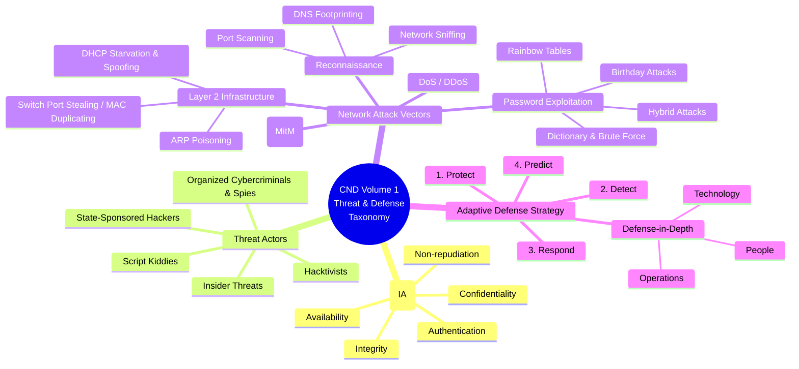
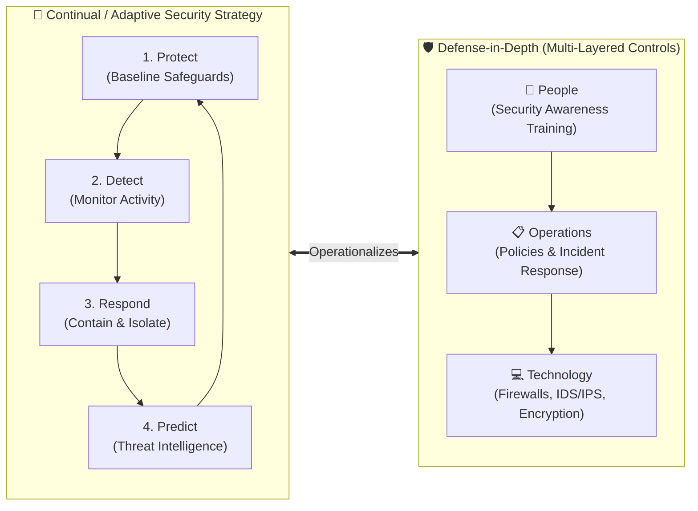
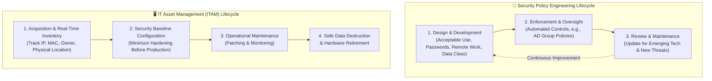
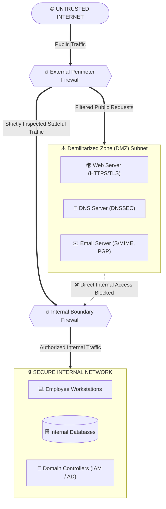
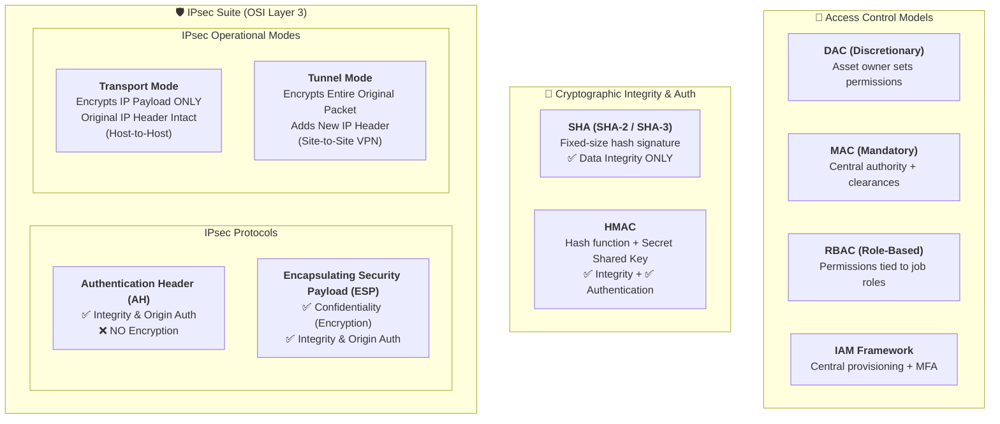
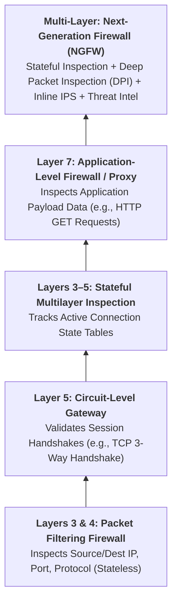
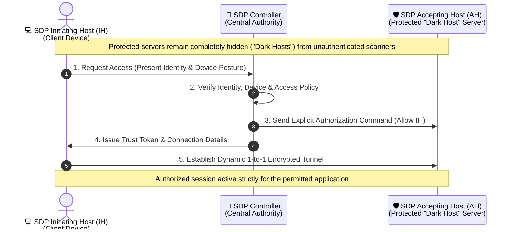

# 📊 CND v3 Volume 1: Visual Architecture & Taxonomy Diagrams

These visual diagrams are rendered natively using **Mermaid.js** and cover the core architectures, taxonomies, and protocol flows in Volume 1 (Modules 1–4)[cite: 1, 3, 6, 9].

---

## 1. Module 01: Threat & Defense Taxonomy (Mind Map)
This branching diagram visualizes the expanded Information Assurance (IA) principles, threat actor classes, network-level attack vectors, and the Continual/Adaptive Security framework[cite: 1, 2, 3].

---

## 2. Module 01: Continual/Adaptive Security & Defense-in-Depth
Defending against modern vectors requires cycling continuously through four operational phases while placing redundant controls across People, Operations, and Technology[cite: 3].

---

## 3. Module 02: Security Policy Lifecycle & IT Asset Management (ITAM)
Technical safeguards rely on administrative governance, structured policy engineering, and full-lifecycle IT asset tracking[cite: 3, 4].

---

## 4. Module 03: Demilitarized Zone (DMZ) Network Segmentation
A DMZ separates the internal private network from untrusted public networks so that if a public-facing server is compromised, direct lateral movement to sensitive internal assets remains blocked[cite: 5, 6, 12].

---

## 5. Module 03: Technical Security Controls & IPsec Comparison
A comparative breakdown of Access Control Models, Cryptographic Hashing Primitives, and IPsec Protocols/Modes[cite: 5, 6, 12].

---

## 6. Module 04: Firewall Evolution Across the OSI Model
Firewalls have evolved from basic stateless header inspection to multi-layered Deep Packet Inspection (DPI) and inline intrusion prevention[cite: 7, 12].

---

## 7. Module 04: Zero Trust Software-Defined Perimeter (SDP) Workflow
Operating under *"Never Trust, Always Verify,"* SDP hides protected infrastructure as "dark hosts" until the central SDP Controller explicitly authenticates the user/device and authorizes a dynamic one-to-one encrypted connection[cite: 8, 9, 12, 13].

