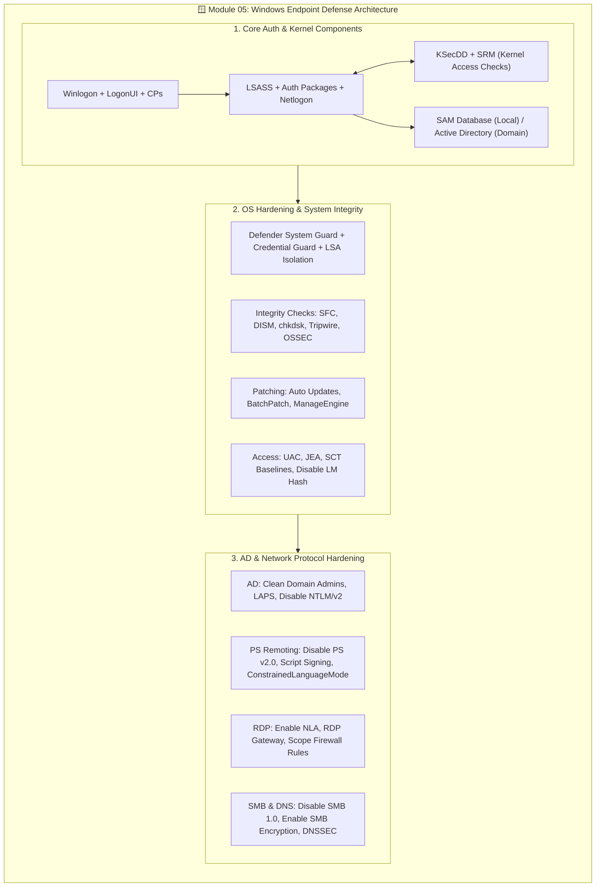

# 🪟 Module 05: Endpoint Security — Windows Systems

**Exam Domain:** Endpoint Protection (20% of Exam 312-38; 5 Questions on Windows Systems)[cite: 11]  
**Core Focus:** Understanding Windows OS security architecture, security features, baseline configurations, user/password management, patch management, OS hardening, Active Directory security, and network protocol hardening[cite: 11, 12].

---

## 🎯 Official Learning Objectives (LO#01 – LO#10)
* **LO#01:** Understand Windows OS and Security Concerns[cite: 11, 12]
* **LO#02:** Discuss Windows Security Components[cite: 11, 12]
* **LO#03:** Discuss Various Windows Security Features[cite: 11, 12]
* **LO#04:** Discuss Windows Security Baseline Configurations[cite: 11, 12]
* **LO#05:** Discuss Windows User Account and Password Management[cite: 11, 12]
* **LO#06:** Discuss Windows Patch Management[cite: 11, 12]
* **LO#07:** Discuss User Access Management[cite: 11, 12]
* **LO#08:** Discuss Windows OS Security Hardening Techniques[cite: 11, 12]
* **LO#09:** Discuss Windows Active Directory Security Best Practices[cite: 11, 12]
* **LO#10:** Discuss Windows Network Services and Protocol Security[cite: 11, 12]

---

## 1. Windows OS & Core Security Components (LO#01 – LO#02)
Understanding Windows security begins with knowing how the operating system architecture processes authentication, logon sessions, and access checks[cite: 12]:

| Windows Security Component | Role in the Security Architecture |
| :--- | :--- |
| **Security Reference Monitor (SRM)** | Kernel-mode component responsible for enforcing access validation and audit generation[cite: 12]. |
| **Local Security Authority Subsystem (LSASS)** | Enforces local security policies, authenticates users, and manages security tokens[cite: 12]. |
| **Security Account Manager (SAM) & SAM Database** | Stores local user accounts and Group information (password hashes)[cite: 12]. |
| **Active Directory (AD)** | Centralized directory service storing domain objects, user accounts, and group policies[cite: 4, 12]. |
| **Authentication Packages** | Dynamic-link libraries (e.g., Kerberos, MSV1_0) that validate user credentials[cite: 12]. |
| **Interactive Logon Manager (`Winlogon`)** | Manages interactive logon/logoff procedures and secure attention sequences[cite: 12]. |
| **Logon User Interface (`LogonUI`) & Credential Providers (CPs)** | Renders the graphical sign-in interface and collects credentials (passwords, PINs, biometrics)[cite: 12]. |
| **Network Logon Service (`Netlogon`)** | Authenticates users and services across domain controllers in a domain network[cite: 12]. |
| **Kernel Security Device Driver (`KSecDD`)** | Facilitates communication between kernel-mode components and user-mode LSASS[cite: 12]. |

---

## 2. Windows Security Features & Baseline Configurations (LO#03 – LO#04)

### Access Checks & Integrity Controls
* **Windows Object Protection & Access Checks:** Resources are protected using **Security Identifiers (SIDs)**[cite: 12]. Defenders can view the SID of all users using **Process Explorer**, **Command Prompt**, **PowerShell**, or the **Windows Registry**[cite: 12].
* **Windows Integrity Control:** Assigns integrity levels to processes to restrict less trustworthy processes from modifying higher-level objects; integrity levels of processes can be viewed using **Process Explorer**[cite: 12].
* **Virtual Service Accounts** & **Secure File Sharing** (assigning right permissions) isolate service privileges and restrict unauthorized file access[cite: 12].

### Advanced Built-In Protections
* **Windows Defender System Guard:** Protects and maintains system integrity during boot and runtime[cite: 12].
* **Windows Defender Credential Guard & LSA Credential Isolation:** Isolates secrets and credentials with the Local Security Authority (LSA) so only privileged system software can access them[cite: 12].
* **Smart App Control & Microsoft Vulnerable Driver Blocklist:** Blocks untrusted or malicious applications and known vulnerable kernel drivers[cite: 12].
* **Phishing Protection & Windows Hello for Business:** Protects users against credential theft and replaces passwords with strong two-factor/biometric authentication tied to the device[cite: 12].

### Security Baseline Configurations (LO#04)
* Organizations verify and enforce Windows security baseline configurations using the **Microsoft Security Compliance Toolkit (SCT)** baseline[cite: 12].

---

## 3. User Account, Password, Patch & Access Management (LO#05 – LO#07)

### User Account & Password Management (LO#05)
* **Disable the Guest Account** to prevent unauthenticated local access[cite: 12].
* Configure the **Domain Password Policy** (including setting password length using PowerShell, enforcing **password complexity requirements**, and enforcing **password history**)[cite: 12].
* Protect stored credentials using **Credential Guard**[cite: 12].

### Windows Patch Management (LO#06)
* **Enable Automatic Updates** via the **Windows Registry**, **PowerShell**, or **Command Prompt**, and **Disable Force System Restarts** when appropriate for uptime[cite: 12].
* **Remote Patch Management Tools:**
  * **BatchPatch**[cite: 12]
  * **ManageEngine Patch Manager Plus**[cite: 12]

### User Access Management (LO#07)
* **Restrict Access to Files and Folders** (including using PowerShell)[cite: 12].
* **Prevent Unauthorized System Changes:** Turn on **User Account Control (UAC)** using PowerShell[cite: 12].
* **Disable Anonymous Security Identifiers (SID) Enumeration**[cite: 12].
* **Moderate Access to Control Panel** and **Control Access to Command Prompt**[cite: 12].
* **Just Enough Administration (JEA):** Implement role-based administrative access management using PowerShell to grant only the exact privileges required for specific administrative tasks[cite: 12].

---

## 4. Windows OS Security Hardening & System Integrity (LO#08)

### Core OS Hardening Checklist
1. **Set up a BIOS Password** to secure firmware boot settings[cite: 12].
2. **Prevent Windows from Storing the LAN Manager (LM) Hash**[cite: 12].
3. **Restrict Software Installations** and **Manage Application Permissions**[cite: 12].
4. **Disable Unwanted Services** (including disabling Windows services via PowerShell) and **Disable Remote Desktop** when not needed[cite: 12].
5. **Install Antivirus Software** and **Enable Windows Defender Firewall** (view firewall status, inspect firewall rules via PowerShell, and block unused open ports)[cite: 12].
6. **Monitor the Windows Registry** (viewing Registry key data using PowerShell)[cite: 12].
7. **Configure Local Security Authority (LSA) Protection**[cite: 12].

### Windows System Integrity & Checking Tools
* **Hardware/OS Integrity Protections:** **Windows Resource Protection (WRP)** and **System Management Mode (SMM) Protection**[cite: 12].
* **Built-In Integrity Checking Utilities:**
  * **System File Checker (`SFC`):** Scans and restores corrupted Windows system files[cite: 12].
  * **Deployment Image Servicing and Management (`DISM`):** Services and repairs Windows system images[cite: 12].
  * **Windows Check Disk (`chkdsk`):** Checks file system and disk metadata for logical and physical errors[cite: 12].
  * **PowerShell & Hashing:** Perform file system integrity checking using PowerShell and cryptographic hashes[cite: 12].
* **Enterprise File Integrity Monitoring (FIM) Tools:**
  * **Tripwire Enterprise**[cite: 12]
  * **OSSEC**[cite: 12]

---

## 5. Active Directory & Network Protocol Security (LO#09 – LO#10)

### Active Directory (AD) Security Best Practices (LO#09)
* **Clean the Domain Admins Group** to enforce least privilege[cite: 12].
* Deploy **Local Administrator Password Solution (LAPS)** to automatically manage and rotate unique local administrator passwords across domain-joined computers[cite: 12].
* **Disable NTLM and NTLMv2 Protocols** in favor of stronger authentication like Kerberos[cite: 12].
* **Protect Domain Controllers** and **Monitor Active Directory Events** (and logs) for signs of compromise[cite: 12].
* **PowerShell Cmdlets for Securing AD:** View default password policy, audit accounts with "Password Set to Never Expire," force password change at next login, and disable/list inactive user accounts[cite: 12].

### Windows Network Services & Protocol Security (LO#10)

| Service / Protocol | Hardening Best Practices |
| :--- | :--- |
| **PowerShell Remoting (PS Remoting)** | Secure PS Remoting endpoints, enable PowerShell logging, **disable PowerShell v2.0** (to prevent downgrade attacks), enforce **Script Signing**, and use **ConstrainedLanguageMode**[cite: 12]. |
| **Remote Desktop Protocol (RDP)** | Limit the number of RDP users, scope RDP firewall rules, implement **RDP Gateways**, protect credentials over RDP, and enable **Network Level Authentication (NLA)** on RDP servers/clients (including via PowerShell)[cite: 12]. |
| **DNS & DNSSEC** | Manage and secure DNS with **DNSSEC** to protect users from spoofing, and monitor DNS logs for security threats[cite: 12]. |
| **Server Message Block (SMB)** | **Disable SMB 1.0** (vulnerable to legacy exploits) and **enable SMB Encryption** (including via Windows PowerShell)[cite: 12]. |

---

## 📊 Module 05 Visual Architecture Diagram (Mermaid.js)

---

## 🧠 Module 05 Quick-Check Flashcards

<b>Q1: Which solution automatically manages and rotates unique local administrator passwords on domain-joined Windows machines, and which legacy authentication protocols should be disabled in Active Directory?</b>

 
<b>Answer:</b> <b>Local Administrator Password Solution (LAPS)</b> manages local admin passwords[cite: 12]. Defenders should disable <b>NTLM and NTLMv2</b> protocols (as well as preventing Windows from storing the legacy <b>LAN Manager [LM] Hash</b>)[cite: 12].

<b>Q2: What four measures are used to secure PowerShell Remoting and prevent PowerShell downgrade/script attacks?</b>

 
<b>Answer:</b>
<ol>
  <li>Enable <b>PowerShell Logging</b>[cite: 12].</li>
  <li><b>Disable PowerShell v2.0</b>[cite: 12].</li>
  <li>Enforce <b>Script Signing</b> for PowerShell scripts[cite: 12].</li>
  <li>Use <b>ConstrainedLanguageMode</b> of PowerShell[cite: 12].</li>
</ol>

<b>Q3: How do you harden Remote Desktop Protocol (RDP) and Server Message Block (SMB) on Windows endpoints?</b>

 
<b>Answer:</b>
<ul>
  <li><b>RDP Hardening:</b> Disable RDP if unused; otherwise, limit RDP users, scope RDP firewall rules, deploy <b>RDP Gateways</b>, and enable <b>Network Level Authentication (NLA)</b>[cite: 12].</li>
  <li><b>SMB Hardening:</b> <b>Disable SMB 1.0</b> and <b>enable SMB Encryption</b>[cite: 12].</li>
</ul>

<b>Q4: Name the built-in Windows utilities and third-party tools used for Windows System Integrity Checking and Remote Patch Management.</b>

 
<b>Answer:</b>
<ul>
  <li><b>Built-in Integrity Utilities:</b> System File Checker (<code>SFC</code>), Deployment Image Servicing and Management (<code>DISM</code>), Windows Check Disk (<code>chkdsk</code>), and PowerShell/Hashing[cite: 12].</li>
  <li><b>Third-Party Integrity Monitoring:</b> <b>Tripwire Enterprise</b> and <b>OSSEC</b>[cite: 12].</li>
  <li><b>Remote Patch Management Tools:</b> <b>BatchPatch</b> and <b>ManageEngine Patch Manager Plus</b>[cite: 12].</li>
</ul>

<b>Q5: What is Just Enough Administration (JEA) and Microsoft Security Compliance Toolkit (SCT)?</b>

 
<b>Answer:</b>
<ul>
  <li><b>JEA (Just Enough Administration):</b> A PowerShell security technology that enables delegated, role-based administrative access for specific tasks without granting full administrator privileges[cite: 12].</li>
  <li><b>SCT (Security Compliance Toolkit):</b> A Microsoft toolkit used to check, manage, and enforce Windows security baseline configurations[cite: 12].</li>
</ul>

